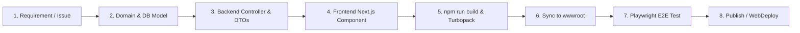

# Uno_CRM & Uno_ERP System Architecture, Backlog & Delivery Guide

> Comprehensive technical documentation covering codebase structure, development standards, delivery workflows, health checks, and architectural decisions for **Uno_CRM** within the **Uno_ERP** travel operations and DMC management ecosystem.

---

## Quick Reference Navigation (Matched to Orchestrator Menu)

| Option | Area | Key Reference |
|---|---|---|
| 🔍 **Load the codebase** | [1. Codebase Architecture & Navigation](#1-codebase-architecture--navigation) | Full folder map, tech stack, port bindings, route table |
| 📋 **Review backlog** | [2. Backlog, Sprint History & Issue Rules](#2-backlog-sprint-history--issue-rules) | Implemented capabilities, active sprints, `.agents/AGENTS.md` rules |
| 🛠️ **Start a new feature** | [3. Feature Delivery Cycle & Deployment Pipeline](#3-feature-delivery-cycle--deployment-pipeline) | Step-by-step workflow, MSBuild target rules, WebDeploy config |
| 📊 **Project health check** | [4. Project Health, Quality & E2E Testing](#4-project-health-quality--e2e-testing) | Architecture assessment, Playwright test suite, performance |
| ❓ **Ask me anything** | [5. Technical Decisions, Standards & Troubleshooting](#5-technical-decisions-standards--troubleshooting) | IIS hosting, UI density rules, authentication, common FAQs |

---

## 1. Codebase Architecture & Navigation (🔍 Load the Codebase)

### 1.1 Solution Overview & Repository Locations

```
c:\Ersen\Projects_2025\Uno_ERP\
├── Uno_CRM/                  # Next.js 16 (Turbopack) + React 19 Frontend SPA (Port 8000)
│   ├── src/
│   │   ├── app/             # Next.js App Router (Pages & Layouts)
│   │   ├── components/      # Reusable UI widgets & feature components
│   │   └── lib/             # API client, utilities, formatting helpers
│   ├── out/                 # Static export directory (HTML/JS/CSS assets)
│   └── package.json         # Scripts, dependencies, and postbuild sync
├── Uno_API/                  # ASP.NET Core 9/10 Web API Backend (Port 8001)
│   ├── Uno_API/
│   │   ├── Controllers/     # REST API Controllers
│   │   ├── Models/          # EF Core entity models
│   │   ├── DTOs/            # Data transfer contracts
│   │   ├── Data/            # UnoDbContext & migrations
│   │   └── wwwroot/         # Target host directory for static Uno_CRM export
│   └── Uno_API.Tests/       # Backend Unit & Integration test projects
├── tests/
│   └── e2e/                 # Python Playwright automated E2E test suites
├── docs/                     # Architectural specifications, manual guides & proposals
├── UserManuals/              # Business process workflows, checklists & transition guides
└── .agents/
    └── AGENTS.md            # Lessons learned & mandatory cross-agent project rules
```

### 1.2 Technology Stack

- **Frontend (`Uno_CRM`)**:
  - Framework: Next.js 16.2.9 (App Router, Turbopack, `output: 'export'`)
  - Runtime & Library: React 19.2.7, TypeScript 6.0.3
  - Styling: Tailwind CSS 3.4.1 (`tailwindcss-animate`), custom ERP high-density styling
  - Visuals & Graphs: Recharts 3.8.1, Lucide React Icons
  - Interactive & DnD: `@dnd-kit/core`, `@dnd-kit/sortable`
  - Excel Processing: `xlsx` (SheetJS)
- **Backend (`Uno_API`)**:
  - Runtime: .NET 9.0 / .NET 10.0 ASP.NET Core Web API
  - ORM: Entity Framework Core with SQL Server & local fallback
  - Communication: JSON REST APIs, Swagger / OpenAPI UI
- **Port Allocation**:
  - `Uno_CRM` Next.js Dev Server: `http://localhost:8000`
  - `Uno_API` ASP.NET Core API: `http://localhost:8001` (or integrated at `8001/api/...` when deployed)

### 1.3 Route Map & Entry Points

| Path | Component / Page | Description |
|---|---|---|
| `/` | `src/app/page.tsx` | Root redirect to `/dashboard` or `/login` based on session state |
| `/login` | `src/app/login/page.tsx` | Authentication screen, demo persona selection & JWT handling |
| `/dashboard` | `src/app/dashboard/page.tsx` | Executive KPI dashboard, Gantt charts, operational status counts |
| `/projects` | `src/app/projects/page.tsx` | Project listing, search, status filtering, and project creation |
| `/projects/[id]` | `src/app/projects/[id]/page.client.tsx` | Project details, budget, tour list, financial view & audit logs |
| `/projects/[id]/tours/[tourId]` | `src/app/projects/[id]/tours/[tourId]/page.client.tsx` | Main Tour Operations hub (Status Gate, Services, Guides, Financials) |
| `/tours` | `src/app/tours/page.tsx` | Global Tour list with multi-criteria filtering and batch actions |
| `/tour-calendar` | `src/app/tour-calendar/page.tsx` | Visual calendar of tour start/end dates and guide allocations |
| `/bookings` | `src/app/bookings/page.tsx` | Passenger manifests, rooming lists, and agency booking entries |
| `/finance` | `src/app/finance/page.tsx` | Receivables, payables, supplier invoices, and profit margins |
| `/master-data` | `src/app/master-data/page.tsx` | Suppliers, Hotels, Transport, Guides, Excursions, Clients |
| `/audit-logs` | `src/app/audit-logs/page.tsx` | Full system audit trail, field diff inspection, user attribution |
| `/guide/tours/[tourId]` | `src/app/guide/tours/[tourId]/page.tsx` | Dedicated Mobile Guide Portal for on-tour excursion sales & pax |

---

## 2. Backlog, Sprint History & Issue Rules (📋 Review Backlog)

### 2.1 Implemented Capabilities & Milestone History

1. **Sprint 1 & 2: Core Domain & Data Flow**
   - Projects, Tours, Clients, Suppliers, and Services CRUD.
   - EF Core migrations, seeding master datasets, and initial Swagger contracts.
2. **Sprint 3: Tour Lifecycle & Status Gate Readiness**
   - Strict status transition engine: `Draft` ➔ `Quote` ➔ `Confirmed` ➔ `In Progress` ➔ `Completed` / `Cancelled`.
   - `TourCheckpointWidget`: Automated checklist validating hotel bookings, transport assignments, guide confirmations, and client deposits before gate unlock.
   - Missing Main Services warning banner with 1-click **Resolve Missing** tab navigation.
3. **Sprint 4: Audit Trails & Financial Intelligence**
   - `EntityAuditHistorySection`: Chronological change logs capturing entity property diffs, user IDs, and timestamps.
   - Tour Financial summary cards (Total Revenue, Total Service Cost, Profit Margin %).
   - Executive Dashboard with interactive Recharts KPI trend cards and Gantt timeline charts.
4. **Sprint 5: UI Slimming & ERP Information Density**
   - Reduced visual bloat across all cards by 50% (Tour Overview, Project Information, Financial Cards, Audit History, Status Gate widget).
   - Strict rule: All top-overview summary headers and badge groups must fit within **max 2 lines**.

### 2.2 Mandatory Project Rules (from `.agents/AGENTS.md`)

Agents and developers working on Uno_ERP must adhere to these non-negotiable rules:

1. **Verify File Paths (Backend / API Generation)**:
   - When generating or editing backend code, verify files reside in `Uno_API/Uno_API/Controllers`, `Models`, etc., not temporary scratch folders.
2. **GitHub Issue Status Verification**:
   - An issue must **NEVER** be marked "Done" or "Closed" unless **BOTH** Frontend UI and Backend API are fully implemented, verified, and pushed.
3. **Strict UI and API Issue Separation**:
   - Work items must be split into dedicated `[Frontend]` and `[Backend]` tickets.
4. **End-to-End Test Automation Requirement**:
   - All completed features must have an automated Playwright test under `tests/e2e/`. True bug regressions must trigger issue reopen.
5. **E2E Test Suite Storage Location**:
   - All Playwright test scripts must reside in `tests/e2e/` (e.g. `tests/e2e/test_ui_slimmer_verification.py`).

---

## 3. Feature Delivery Cycle & Deployment Pipeline (🛠️ Start a New Feature)

### 3.1 End-to-End Development Workflow



1. **Backend Model & Migration**:
   - Add/update entities in `Uno_API/Uno_API/Models/`.
   - Update `UnoDbContext.cs` and generate migration:
     ```powershell
     dotnet ef migrations add AddFeatureName -p Uno_API\Uno_API
     dotnet ef database update -p Uno_API\Uno_API
     ```
2. **Controller & Endpoint Creation**:
   - Add controller in `Uno_API/Uno_API/Controllers/`. Ensure appropriate DTOs are mapped.
3. **Frontend Component & Page Development**:
   - Create UI in `Uno_CRM/src/app/` or `Uno_CRM/src/components/`.
   - Respect high-density layout rules: `rounded-xl`, `px-4 py-1.5` to `py-2`, compact typography (`text-xs`, `text-sm`), and inline subtitles.
4. **Production Build & Verification**:
   - Build frontend:
     ```powershell
     cd Uno_CRM
     npm run build
     ```
   - Turbopack compiles in static export mode (`out/`).
   - The `postbuild` hook automatically executes:
     `Copy-Item -Path 'out\*' -Destination '../Uno_API/Uno_API/wwwroot' -Recurse -Force`
5. **End-to-End Testing**:
   - Run the Playwright test suite to confirm zero regressions:
     ```powershell
     python tests/e2e/test_ui_slimmer_verification.py
     ```

### 3.2 MSBuild SPA Target Architecture (Preventing Publish Errors)

When deploying via Visual Studio or `dotnet publish`, Node-generated files in `wwwroot` can trigger MSBuild file-locking or `MSB4006` circular dependency errors. Follow this exact pattern in `Uno_API.csproj`:

```xml
<PropertyGroup>
  <StaticWebAssetsEnabled>false</StaticWebAssetsEnabled>
</PropertyGroup>

<Target Name="BuildSpaTarget" BeforeTargets="BeforeBuild;ComputeFilesToPublish" 
        Condition="('$(BuildSpa)' == 'true') and '$(SpaHasBuilt)' != 'true' and Exists('$(SpaProjectDir)\package.json')">
  <Message Text="Building SPA for API..." Importance="high" />
  <Exec WorkingDirectory="$(SpaProjectDir)" Command="npm run build" />
  <PropertyGroup>
    <SpaHasBuilt>true</SpaHasBuilt>
  </PropertyGroup>
  <ItemGroup>
    <Content Remove="wwwroot\**" />
    <Content Remove="wwwroot\**\*" />
    <Content Include="wwwroot\**" CopyToPublishDirectory="PreserveNewest" />
  </ItemGroup>
</Target>
```

### 3.3 IIS Shared Hosting & WebDeploy (.pubxml) Best Practices

1. **Untrusted SSL Certificates**:
   - Shared hosting providers frequently rotate intermediate certificates. Ensure `<AllowUntrustedCertificate>true</AllowUntrustedCertificate>` is present in `.pubxml`.
2. **Site Root vs. Virtual Directory**:
   - Set `<DeployIisAppPath>site_identifier</DeployIisAppPath>`.
   - **Do NOT** append `/wwwroot`. Appending `/wwwroot` pushes API binaries into a nested subdirectory, breaking the application.

---

## 4. Project Health, Quality & E2E Testing (📊 Project Health Check)

### 4.1 Architecture & Quality Assessment

- **Separation of Concerns**: Clean isolation between Presentation (`Uno_CRM`), API / Business Rules (`Uno_API`), and Database (`EF Core / SQL Server`).
- **Static Export Resilience**: Static generation ensures zero SSR node runtime crashes on shared hosting; dynamic data is fetched client-side with proper error handling and fallback skeletons.
- **Type Safety**: Full TypeScript typing on all frontend API contracts; C# records/DTOs on backend.
- **Design System Consistency**: Consistent color palettes (Slate/Blue/Emerald/Rose for statuses), Lucide icons, responsive drawer navigation, and ultra-compact card layouts.

### 4.2 Automated Testing Pipeline

All UI interaction workflows are covered by Python Playwright test scripts under `tests/e2e/`:
- **File**: [`tests/e2e/test_ui_slimmer_verification.py`](file:///c:/Ersen/Projects_2025/Uno_ERP/tests/e2e/test_ui_slimmer_verification.py)
- **Covered Scenarios**:
  1. Tour Information overview header & badge density (max 2 lines).
  2. Missing Main Services warning banner and 1-click **Resolve Missing** button navigation.
  3. Status Gate Readiness checklist expansion and item card layout.
  4. Entity Audit History timeline rendering and row height verification.
  5. Financial Summary cards (Total Revenue, Cost, Profit) compactness.
  6. Project Information card (50% slimmed header, inline subtitle, edit button).
- **Execution Command**:
  ```powershell
  python tests/e2e/test_ui_slimmer_verification.py
  ```

---

## 5. Technical Decisions, Standards & Troubleshooting (❓ Ask Me Anything)

### 5.1 Key Architectural Decisions

1. **Why Next.js Static Export (`output: 'export'`)?**
   - Enables deployment to standard IIS shared hosting or Windows VPS without managing a separate Node.js reverse proxy or PM2 process. ASP.NET Core serves static files directly from `wwwroot` and handles SPA client routing.
2. **Session & Auth Model**:
   - Client session stored in `localStorage` under `uno_erp_user_session` containing `email`, `name`, `role`, and `loginTime`.
   - Role-based permissions evaluated using `<Can do="edit" on="Project">` components (`Can.tsx`).
3. **UI Density Policy (50% Slimmer ERP Design)**:
   - ERP operators require high information density. Headers and card padding are strictly constrained:
     - Card padding: `p-4` (previously `p-6`).
     - Header padding: `px-4 py-1.5` to `py-2`.
     - Font scaling: `text-sm font-bold` for section titles, `text-[10px]` for uppercase labels.
     - Single-row alignment: Subtitles placed inline with bullet separators rather than stacked.

### 5.2 Common Troubleshooting & Solutions

| Symptom | Probable Cause | Immediate Fix |
|---|---|---|
| **404 on Page Refresh in IIS** | Missing URL Rewrite rule for SPA fallback | Check `web.config` in `wwwroot` has rewrite rule routing all non-file requests to `/index.html`. |
| **Changes in Uno_CRM not showing on port 8001** | `postbuild` sync was not executed | Run `npm run build` in `Uno_CRM` to trigger automatic copy to `Uno_API/Uno_API/wwwroot`. |
| **WebDeploy fails silently or error certificate** | Self-signed or rotated host SSL certificate | Add `<AllowUntrustedCertificate>true</AllowUntrustedCertificate>` to the `.pubxml` file. |
| **CORS errors when accessing API on 8001** | Frontend running on port 8000 in dev | Verify `Program.cs` in `Uno_API` enables CORS for `http://localhost:8000`. |
| **Playwright test fails to launch** | Chrome executable path mismatch | Ensure `C:\Program Files\Google\Chrome\Application\chrome.exe` is installed or update path in script. |

---

*Document maintained by Uno_ERP Core Engineering Team. Updated September 2026.*
